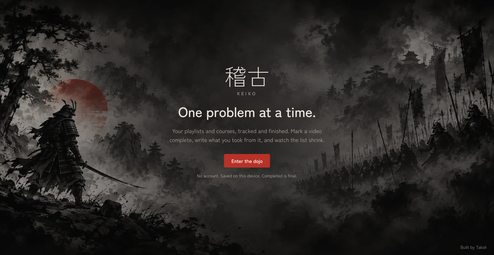

# Keiko (稽古)

**One problem at a time.** — A minimal progress tracker for playlists and courses.

[](./LICENSE)
[](https://keiko-log.vercel.app/)

---

## Demo



Live: [https://keiko-log.vercel.app/](https://keiko-log.vercel.app/)

---

## Features

- Track any playlist or course, video by video
- Mark a video complete — requires a written note, cannot be undone
- Notes auto-save as drafts; draft survives a page refresh
- Filter by All / Remaining / Completed within each playlist
- Export progress to a dated JSON file; import it back on any device
- No account, no backend, no auth — everything lives in the browser

---

## How progress is stored

Progress is saved in `localStorage` under the key `keiko:v1`. The shape is:

```json
{
  "version": 1,
  "progress": {
    "video-id": {
      "note": "What I learned or did.",
      "completedAt": "2026-10-11T07:00:00.000Z"
    }
  }
}
```

- A video without `completedAt` is a draft note (in progress).
- A video with `completedAt` is completed. That field is never removed — **completion is final**.
- **Clearing browser data wipes all progress.** Use Export before clearing, switching browsers, or moving devices.

### Export / Import

From the Playlists page, click **Export** to download a `keiko-progress-YYYY-MM-DD.json` backup. Click **Import** to restore it. The import dialog shows how many completed videos will be added or removed before you confirm. If the incoming file has fewer completed videos than the current state, you must type `REPLACE` to proceed.

---

## Run locally

Requires Node.js (LTS, compatible with Next.js 16).

```bash
git clone https://github.com/TakshPatel02/Keiko-Log.git
cd keiko
npm install
npm run dev
```

Open [http://localhost:3000](http://localhost:3000).

Available scripts (from `package.json`):

| Script | What it does |
|---|---|
| `npm run dev` | Start development server |
| `npm run build` | Build for production |
| `npm start` | Start production server (after build) |
| `npm run lint` | Run ESLint |

---

## Following a different playlist or course? Fork it.

The main repo only contains the Chai aur Code playlists. If you want to track something else, fork the repo and edit the data file. **Do not open a PR to add unrelated playlists to the main repo.**

### Steps

**1. Fork and clone**

Fork on GitHub, then:

```bash
git clone https://github.com/TakshPatel02/Keiko-Log.git
cd keiko
npm install
```

**2. Edit `src/data/playlists.ts`**

The `playlists` array is the only thing you need to change. Each entry uses this shape (taken directly from the existing data):

```ts
{
  id: "my-playlist-01",           // unique slug, URL-safe, used as the route and localStorage key
  title: "My Course Title",
  description: "Short description of what this playlist covers.",
  completed: false,               // false = still releasing; true = no new videos coming
  videos: [
    {
      id: "my-playlist-01-001",   // unique, stable — never change after you start tracking
      title: "First Video Title",
      description: "What this video covers.",
      url: "https://youtu.be/XXXXXXXXXXX"  // optional; opens in a new tab from the detail page
    },
    // add more videos here
  ]
}
```

> **Important:** `id` values are the keys stored in `localStorage`. Never rename an `id` after you have started tracking — it will orphan your saved progress for that video.

**3. Verify locally**

```bash
npm run dev
```

Check that your playlists appear at `/playlists` and that each detail page loads correctly.

**4. Deploy**

[](https://vercel.com/new/clone?repository-url=https://github.com/[REPO_URL])

Or deploy manually:

```bash
npm run build
npm start
```

---

## Preloaded playlists

The main repo ships with three playlists from **[Chai aur Code](https://www.youtube.com/@chaiaurcode)** (Hitesh Choudhary's team):

| Playlist | Status |
|---|---|
| DSA with Chai aur Code | Completed series |
| Chai aur LeetCode (Array) | Completed series |
| Chai aur LeetCode (String) | Still releasing |

New videos for ongoing playlists are added to this repo manually as they are published.

---

## Contributing

Bug fixes, UI/UX improvements, and new videos for the existing Chai aur playlists are welcome.
See [CONTRIBUTING.md](./CONTRIBUTING.md) for setup, branch naming, commit style, and PR guidelines.

---

## License

MIT — see [LICENSE](./LICENSE).
